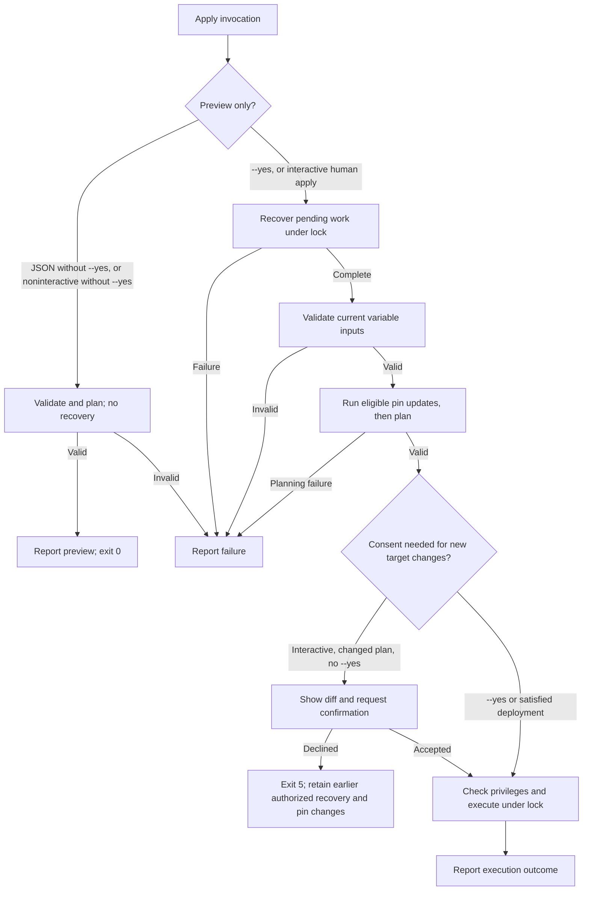

# Deployment

Apply resolves current desired configuration, previews its target changes, and executes an authorized deployment. Recovery and remote-pin changes have their own authorization boundaries; declining a new target diff does not reverse earlier authorized effects.

## Planning and consent

### REQ-deployment-plan — Deployment plan

For each active declaration, classify each target as `create` when absent, `unchanged` when its entry kind and desired content match, and `update` otherwise. Copies and rendered output require matching regular files. Symlinks require the desired link destination after Windows verbatim-prefix simplification, rather than merely equal referent bytes. Tree modes classify leaves and aggregate the destination: a missing nonempty tree is created, a tree with changed leaves is updated, and an empty absent tree is unchanged.

Plan all file declarations across alphabetically ordered modules, then all directory declarations across alphabetically ordered modules. Within each module and declaration kind, preserve authored declaration and fan-out order. Sort tree leaves by relative path and append orphan removals in target-path order. Use the same effective profile and variables for operations and managed membership. Validate the complete plan, including collisions, before showing its diff.

The human preview identifies creation, replacement, unchanged entries, and removal, with source/target mappings and content changes where applicable. Planning is an observation rather than a filesystem snapshot; callers coordinate external source and target edits until execution completes.

**Scenarios:**

- A target symlink reaches bytes equal to a desired copy; the plan reports `update` because the required kind is a regular file.
- A template's variables change its output; the plan compares that rendered output with the existing target.
- A source tree is entirely ignored and its target is absent; the aggregate is `unchanged` and no directory creation is proposed.
- A plan has a collision; apply reports the conflicting declarations before showing a deployable diff.
- Module `a` declares a directory and module `b` declares a file; the file from `b` precedes the directory from `a` in the plan and execution.

### REQ-deployment-consent — Deployment consent

Human apply with interactive stdin displays the plan and requires trimmed `y` or `Y` to execute changes unless `--yes` is supplied. Other input, EOF, or failed input reading declines with exit `5`. Noninteractive human apply without `--yes` is a successful preview. JSON apply without `--yes` is a successful preview even with interactive stdin. `--yes` authorizes deployment subject to validation and required Windows privilege checks.

Previews do not deploy targets, recover pending work, run hooks, request elevation, or rewrite repository content. They can create coordination state and prepare a cold remote cache as specified by the runtime and remote areas. Human interactive apply can recover old work before the new preview under REQ-recovery-authorization; a later decline applies to the new deployment only.

**Scenarios:**

- A noninteractive invocation runs plain `apply`; it prints the plan and exits `0` without writing target files.
- An interactive invocation runs `apply --json`; it returns a preview object without prompting or running hooks.
- The user declines a human diff; apply exits `5` without executing that plan.
- The user passes `--yes`; a missing required symlink privilege still follows the Windows elevation policy.

The following informative diagram summarizes command authorization. Detailed hook, failure, and commit outcomes are defined in their requirement blocks below.

### REQ-satisfied-deployment — Satisfied deployment

If every operation is unchanged, no removal is needed, and a usable committed expectation record exists, a consented apply is a full no-op. It does not run hooks, resolve hook executables, create deployment backups, publish new history, or rewrite targets. It does not require a new target-change prompt. Repeated unchanged invocations satisfy deterministic stdout. The first empty apply can establish a baseline record; a mixed deployment preserves unchanged targets while recording their continued ownership.

**Scenarios:**

- A satisfied repository has a post-hook with external effects; repeating apply does not execute that hook or change the committed record's bytes or modification time.
- One target is unchanged and another needs creation; the unchanged target is not rewritten, and both remain recorded after commit.
- An empty repository has no history; an authorized first apply creates its baseline, and later satisfied applies create no new record.

## Execution and failures

### REQ-target-materialization — Target materialization

After consent and required platform checks, execute under the exclusive machine-state lock. Preserve prior entries through the history contract before overwriting or removing them. Materialize symlinks, copies, rendered files, and tree leaves according to their declared modes. Create needed real parent directories and replace mismatching target kinds through the planned operation. A copy does not silently become a symlink and a failed symlink does not silently become a copy.

Process interruption leaves recoverable pending work until commit. Ordinary filesystem failures report the cause and retain pending recovery material when immediate reversal has not completed. Windows file operations tolerate transient sharing violations with bounded local retries; retries do not re-run whole commands or hooks. External edits after backup and before writing are outside the coordinated-edit guarantee.

**Scenarios:**

- A copy replaces an existing target symlink; the prior link is backed up and the target becomes a regular file.
- A filesystem write fails after another target changed; apply fails and retains enough pending state for authorized recovery.
- An interrupted tree replacement has a complete root backup; recovery can restore that root even though committed rollback later uses per-leaf expectations.
- A Windows scanner temporarily prevents a supported write; local retries can complete the same operation without executing hooks a second time.

### REQ-apply-hooks — Apply hooks

Module `[[hook]]` entries declare required string `event` and `command`, optional string `shell`, optional expression string `when`, and optional boolean `must_succeed` defaulting to true. Events are `pre_apply` and `post_apply`. Select hooks in module and declaration order, evaluate conditions in the declaring module's context, and pass command strings verbatim to the shell without template rendering. Default shells are `bash` on Linux and macOS and `pwsh` on Windows. PowerShell executables use `-Command`; other shells use `-c`.

Hooks execute synchronously with the invocation's working directory, environment, and stdin. Human execution inherits hook stdout and stderr. JSON execution routes hook stdout to stderr so application stdout remains structured. There is no automatic hook retry or specified timeout. Pre-hooks precede new deployment writes; post-hooks follow materialization and precede orphan removal. Successful post-hook changes to deployed content become the committed expectations. External hook effects outside journaled target changes are not automatically reversed.

Reject detectable invalid hook configuration before new deployment changes. Once execution begins, apply the same failure policy to nonzero exit, expression evaluation failure, missing executable, and invocation failure:

- A required pre-hook failure aborts new deployment operations with exit `2`.
- A required post-hook failure reverses completed deployment changes and exits `3` when reversal succeeds. Incomplete reversal reports failure and retains recovery material.
- An optional hook failure warns and execution continues. `--force-deploy` makes runtime hook failures optional for that invocation; it does not excuse invalid configuration or suppress diagnostics.

**Scenarios:**

- A required default pre-hook shell cannot launch after validation; apply exits `2` before planned target writes.
- An optional post-hook cannot spawn under JSON execution; the command warns on stderr and can commit with one JSON result on stdout.
- A required post-hook exits nonzero after creating a target; reversal removes that creation and apply exits `3`.
- A required post-hook edits a copied target and succeeds; status compares against those final edited bytes after commit.
- A configured hook expression is syntactically invalid; validation rejects it before new deployment changes, including under `--force-deploy`.
- A module declares `[[hook]]` with `event = "pre_apply"` and a command that writes a marker; a changing authorized deployment runs it before materializing targets.

### REQ-orphan-removal — Orphan removal

Compare prior effective recorded targets with current managed membership and propose removal only for existing recorded entries that are no longer governed by a current target and are not real directories. Use reason `ignored` for leaves excluded by current ignore rules and `unmanaged` for other lost membership. Protect descendants covered by a current whole-directory target. When a current tree root is no longer a real directory, exclude that root and its recorded descendants from orphan removal through it.

Show the exact removal set before consent and record it in the durable plan. After successful or tolerated post-hooks, remove only that set, using complete backups. An already absent candidate is harmless; a candidate that became a real directory is refused. Leave auxiliary directories alone. Ancestor links outside the current-tree protection remain subject to the root spec's filesystem assumptions.

**Scenarios:**

- A previously deployed leaf is newly ignored; the plan shows an `ignored` removal and consented apply backs it up before removal.
- A source leaf disappears; apply removes its old recorded target while preserving unrelated siblings and their parent directory.
- A tree becomes a whole-directory symlink; orphan removal does not traverse the new link to delete its source leaves.
- A planned orphan leaf becomes a real directory before execution; the executor fails instead of deleting that directory recursively.

### REQ-deployment-commit-outcome — Deployment commit outcome

Commit after materialization, required hook handling, and planned orphan removal complete. Required persistent publication belongs to the operation's success boundary. Once the committed record is published, failure to deliver result output or perform housekeeping does not reverse deployment or turn its completed deployment result into failure. Housekeeping includes pending-file cleanup, history retention, recovered-copy retention, and automatic remote-cache pruning. Warn where output remains available, without describing the committed operation as reversed.

**Scenarios:**

- JSON stdout is closed before a consented copy deployment; the target and committed state can be saved and apply exits `0` even though the reader receives no document.
- Recovered-copy pruning fails after commit; apply warns and reports successful deployment.
- Publishing the committed body fails before the terminal record is visible; apply reports failure and retains pending recovery state.
- Pending-plan deletion fails after terminal publication; the next recovery operation recognizes the commit and does not reverse it.

### REQ-apply-json — Apply JSON

Apply JSON has `repo_root`, `profile`, `plan`, `reaped`, and `result`. Plan rows have `mode`, `source`, `target`, and `state`. Modes are `symlink`, `symlink-tree`, `copy`, and `template`; states are `create`, `update`, and `unchanged`. Nonempty tree plans expose rows per leaf; entries without leaves expose the aggregate row. Reaped rows have `target` and reason `ignored` or `unmanaged`. Result is `previewed`, `applied`, `aborted`, or `rolled_back` for the corresponding completed command path. Generic failures follow the shared stderr error contract.

Plan fields describe the resolved pre-execution plan even when execution fails or reverses it; they do not claim every row remains deployed. Hook diagnostics and privilege-request explanations remain on stderr. Full no-op execution returns `applied` without publishing a new history record.

**Scenarios:**

- A tree plan has two included leaves; JSON reports both leaf sources, targets, and dispositions in stable order.
- A required post-hook fails and reversal succeeds; result is `rolled_back`, exit is `3`, and the original plan remains inspectable.
- JSON execution requests Windows elevation; explanatory prose does not precede the JSON result on stdout.
- Two consecutive satisfied JSON executions run against the same inputs; their complete stdout bytes match.

## Supporting evidence

[Transaction and recovery research](../docs/research/transactions-and-recovery.md) traces consent, plan classification, no-op tests, hook failure gaps, commit cleanup, and the closed-output probe. [Command and platform research](../docs/research/commands-and-platform.md) records structured-output branch defects and platform verification limits.
